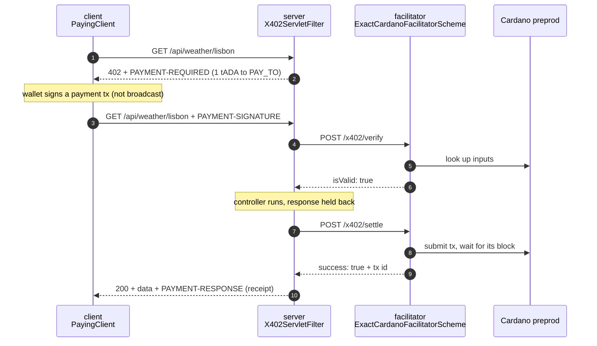

# x402 Java v2 demo

A complete x402 setup in Java on Cardano preprod: a **facilitator**, a **paid API** and a **paying client**, each one small Maven module. It shows the two ways to make an endpoint paid, the ways to customize a facilitator, and a client that pays without any Spring.



## Run it

You need Java 17+ and Maven, plus three things from preprod:

- a free [Blockfrost](https://blockfrost.io) project id for **Cardano preprod**;
- a 24-word preprod wallet with a few tADA, from the [faucet](https://docs.cardano.org/cardano-testnets/tools/faucet) (the buyer);
- any preprod address of yours (the seller; payments go there).

```bash
# 1. The SDK is not on Maven Central yet: install it from the x402 repo once.
git clone -b feat/java-v2-spring-starter https://github.com/Kammerlo/x402.git
mvn -f x402/java/pom.xml -q install -DskipTests

# 2. Build the demo and configure it.
mvn -q package -DskipTests
cp .env.example .env        # fill in BLOCKFROST_PROJECT_ID, PAY_TO, BUYER_MNEMONIC

# 3. Run: starts facilitator and server, walks through the demo, stops both (~2-3 minutes).
./run.sh
```

What it prints (abridged from a real run):

```
== 1. The server: what is free, what is paid (curl, no payment)
GET /api/status -> HTTP 200
GET /api/weather/lisbon -> HTTP 402
GET /api/reports/ada-usd -> HTTP 402
   The 402's PAYMENT-REQUIRED header, decoded:
     { "x402Version": 2, "accepts": [ { "scheme": "exact", "network": "cardano:preprod",
       "asset": "lovelace", "amount": "2000000", "payTo": "addr_test1qzd…", … } ] }

== 2. The facilitator's customizations (curl)
ApiKeyFilter:  POST /x402/verify without X-Api-Key -> HTTP 401
PayeePolicy:   POST /x402/verify paying an unknown address -> {"isValid":false,"invalidReason":"payee_not_allowed"}

== 3. Paying with the Java client
GET /api/weather/lisbon -> HTTP 200
  {"city":"lisbon","temperatureC":18.4,"humidityPercent":72,"windKmh":14,…}
  paid: https://preprod.cardanoscan.io/transaction/66a996fd…5559
GET /api/reports/ada-usd -> HTTP 200
  {"market":"ada-usd","close":0.4275,"changePercent":-1.8,…}
  paid: https://preprod.cardanoscan.io/transaction/d3e3dc83…5d34

== 4. What the facilitator saw
AuditHooks (log):
   REFUSED payment to addr_test1vz09…: not an allowed payee
   VERIFIED 1000000 lovelace to addr_test1qzd…: valid=true
   SETTLED  tx=66a996fd…: success=true
   VERIFIED 2000000 lovelace to addr_test1qzd…: valid=true
   SETTLED  tx=d3e3dc83…: success=true
StatsController (GET /stats), filled by the hooks and MeteredChainBackend:
   {"chain.getTransactionEvidence":22,"chain.getUtxo":4,"chain.submitTransaction":2,
    "policy.refused":1,"settle.success":2,"verify.valid":2,…}
```

To run the parts by hand, export the variables from `.env`, then start each in its own terminal: `java -jar facilitator/target/*.jar`, then `java -jar server/target/*.jar`, then `mvn -q -pl client exec:java`.

## The server: two ways to make an endpoint paid

The API has three endpoints. Prices are set in [`server/src/main/resources/application.yml`](server/src/main/resources/application.yml):

| Endpoint | Price | Protected by |
|---|---|---|
| `GET /api/status` | free | nothing |
| `GET /api/weather/{city}` | 1 tADA | **an annotation:** `@X402Payment("weather")` in [`WeatherController`](server/src/main/java/demo/server/WeatherController.java) |
| `GET /api/reports/{market}` | 2 tADA | **configuration only:** `path: "GET /api/reports/:market"` in the YAML; [`ReportController`](server/src/main/java/demo/server/ReportController.java) has no x402 code |

Both read the same offer format from YAML:

```yaml
x402:
  accounts:
    seller: { network: "cardano:preprod", pay-to: "${PAY_TO}" }   # where you get paid
  routes:
    weather:                                     # option A: used by @X402Payment("weather")
      accepts: [ { account: seller, price: { amount: "1000000", asset: lovelace } } ]
    market-report:                               # option B: matched by path
      path: "GET /api/reports/:market"
      accepts: [ { account: seller, price: { amount: "2000000", asset: lovelace } } ]
```

**Which one to use:**

- **The annotation** ties the price to the handler method Spring dispatches to. If you change the URL in `@GetMapping`, the endpoint stays paid. If you misspell the offer name, the app refuses to start. Use it for your own controllers.
- **`path:`** protects every request matching the pattern, whatever handles it: another team's controller, a library endpoint, static files. The pattern uses x402 route syntax (`*`, `:param`). Keep it in sync with your mappings yourself.

You can combine them: an annotated offer can also carry a `path:`.

Price in USDM, the network's default stablecoin, by writing `price: "$0.01"` instead of an amount in lovelace. An offer can list several `accepts` entries, and the buyer picks one.

## The facilitator: how to adjust and extend it

[`facilitator/`](facilitator/src/main/java/demo/facilitator) starts from YAML alone. Each class shows one way to change it, from least to most code:

| # | How | Class | What it does |
|---|---|---|---|
| 1 | **Configuration** | [`application.yml`](facilitator/src/main/resources/application.yml) | Confirmation timeout and poll interval, mempool acceptance, maximum transaction size, networks. |
| 2a | **Hooks: observe** | [`AuditHooks`](facilitator/src/main/java/demo/facilitator/AuditHooks.java) | `onAfterVerify` / `onAfterSettle` log and count every payment; `onSettleFailure` sees exceptions. This is where bookkeeping, notifications or metrics go. |
| 2b | **Hooks: refuse** | [`PayeePolicy`](facilitator/src/main/java/demo/facilitator/PayeePolicy.java) | `onBeforeVerify` / `onBeforeSettle` return `Decision.abort("payee_not_allowed")` for sellers you don't serve. The transaction is never submitted. The rule is on both, since settle can be called without verify. |
| 3 | **Plain Spring around it** | [`ApiKeyFilter`](facilitator/src/main/java/demo/facilitator/ApiKeyFilter.java) | `/verify` and `/settle` require an `X-Api-Key` header; `/supported` stays public. The server sends the key through `x402.facilitators[].headers`. Spring Security works the same way. |
| 4 | **Replace a building block** | [`MeteredChainBackend`](facilitator/src/main/java/demo/facilitator/MeteredChainBackend.java) | A `CardanoChainBackend` bean replaces the Blockfrost backend the YAML would build. This one wraps Blockfrost and counts calls; yours could use your own node, Ogmios or Koios. A `SettlementClaimStore` bean (a database instead of memory) plugs in the same way. |
| 5 | **Your own endpoints** | [`StatsController`](facilitator/src/main/java/demo/facilitator/StatsController.java) | `GET /stats` shows what the hooks and the backend counted. The facilitator is an ordinary Spring Boot app. |

Hooks come from `X402FacilitatorCustomizer` beans, and you can have as many as you like:

```java
@Bean
X402FacilitatorCustomizer payeePolicyHooks() {
  return facilitator -> facilitator
      .onBeforeVerify(ctx -> allowed(ctx.requirements().payTo())
          ? HookResults.Decision.proceed() : HookResults.Decision.abort("payee_not_allowed"))
      .onBeforeSettle(ctx -> /* the same check */ ...);
}
```

The same shape exists on the server (`X402ResourceServerCustomizer`) and on the client (`X402Client.onBeforePaymentCreation`, …).

## The client: paying from plain Java

[`PayingClient`](client/src/main/java/demo/client/PayingClient.java) has three steps:

1. **A wallet:** `MnemonicClientCardanoSigner` finds UTxOs through Blockfrost and signs payment transactions offline. It never broadcasts; the facilitator does that.
2. **A payment engine:** `X402Client` with the Cardano exact scheme and `SpendControls`. Spend controls refuse lovelace unless you allow it with a cap, here 3 tADA per payment.
3. **A paying HTTP client:** `X402HttpClient.wrap(jdkHttpClient, payments, HostPolicy)`. On a 402 it picks an option, builds a payment, retries once and returns the paid response. `X402HttpClient.paymentResponse(response)` returns the receipt.

To the client, the annotated endpoint and the YAML-protected one look identical.

## What happens in one paid request

1. The client sends `GET /api/weather/lisbon` without payment.
2. `X402ServletFilter` finds the offer (annotation or path) and answers **402** with `PAYMENT-REQUIRED`: 1 tADA to `PAY_TO` on `cardano:preprod`.
3. The client picks that option and has the wallet sign a transaction paying 1 tADA. It retries with `PAYMENT-SIGNATURE`.
4. The server sends the payment to the facilitator's `/verify`. The facilitator checks amount, recipient, signatures, fee, validity window and unspent inputs.
5. Only now does the controller run. Its response is held back.
6. The server calls `/settle`. The facilitator records a claim, submits the transaction and waits for its block. If the block doesn't arrive within 75 s, it answers `settlement_pending`. The server then retries once, and the retry resumes the same transaction instead of sending it again.
7. The client receives the data and a `PAYMENT-RESPONSE` receipt carrying the transaction id. If settlement fails, the client gets a 402 and the data is never released.

## Notes

- **Demo only.** The facilitator listens on `127.0.0.1`, and its API key defaults to `demo-secret` (override it with `FACILITATOR_API_KEY`). For production, use real authentication and a persistent `SettlementClaimStore`.
- **Fees and funds.** The buyer pays the transaction fee. The facilitator needs no wallet and no funds.
- **Two payments back to back.** The client waits 20 s before the second payment. The wallet may spend the change of the first one, and Blockfrost's nodes can briefly disagree right after a block. Without the pause, the facilitator's pre-submit check can miss that change output and refuse the payment (`nonce_not_on_chain`). It refuses before submitting, so nothing is charged.
- **More.** See the SDK's `java/README.md` for the full configuration reference and the differences from the TypeScript SDK.
